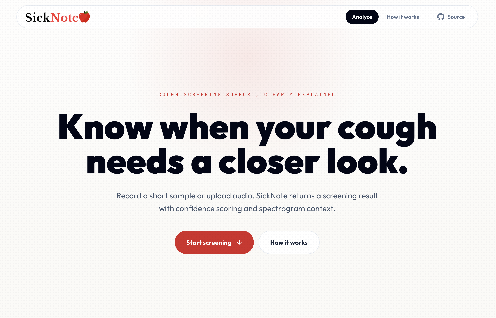

<p align="center">
  
</p>

<p align="center">
  <b>Binary cough classifier: healthy vs. abnormal.</b><br>
  XdHacks Mini Vancouver 2026 · 3rd Place
</p>

<p align="center">
  <a href="https://www.python.org/"></a>
  <a href="https://www.typescriptlang.org/"></a>
  <a href="https://developer.mozilla.org/en-US/docs/Web/CSS"></a>
</p>

<p align="center">
  <a href="https://youtu.be/SuJD9Y44TfE"><b>▶ Watch the demo (YouTube)</b></a>
  &nbsp;·&nbsp;
  <a href="https://www.sicknoteinc.xyz/"><b>Try it live</b></a>
</p>

<p align="center">
  <a href="#results">Results</a> ·
  <a href="#the-model">The model</a> ·
  <a href="#architecture">Architecture</a> ·
  <a href="#key-design-decisions">Trade-offs</a> ·
  <a href="#development">Run it</a>
</p>

---

## What it is

SickNote analyzes a cough recording and returns whether it sounds healthy or abnormal, alongside a Grad-CAM heatmap showing which parts of the spectrogram drove the decision. Audio is converted to a log-mel spectrogram and scored by an ensemble of three small CNNs.

> **Screening support only. Does not replace medical diagnosis.**
> Read [Results](#results) and [What this model actually measures](#what-this-model-actually-measures) before trusting a prediction.

## Results

All figures come from nested 5-fold cross-validation, in which every one of the 2,267 clips is scored exactly once by a model that never trained on it. This matters: the project's original headline number was measured on a single 341-clip split, and the same checkpoints scored 0.645 on a same-size validation split — a 0.09 swing from split assignment alone. That was a draw, not a measurement.

| | mean single model | 3-model ensemble |
|---|---|---|
| previous architecture (flatten head, 5 members) | 0.6798 | **0.6931** |
| current architecture (pooling head + SpecAugment) | 0.7161 | **0.7238** |

**Improvement: +0.0308, 95% CI [+0.0137, +0.0494], better on 5 of 5 folds.** The confidence interval excludes zero.

The model got 20× smaller in the process:

| | before | after |
|---|---|---|
| parameters per model | 1,415,281 | **71,793** |
| ensemble members | 5 | **3** |
| checkpoint size on disk | 54 MB | **876 KB** |

Dropping from 5 members to 3 was also measured rather than guessed: members 4 and 5 contribute +0.0013 combined, which is well inside noise.

Full experiment log, including the five ideas that did not work: [EXPERIMENTS.md](EXPERIMENTS.md).

---

## What this model actually measures

This section exists because the numbers above are easy to over-read.

**A model that hears nothing scores 0.6556.** Three values that require no learning at all — clip duration, peak volume, and mean volume — fed to a logistic regression reach AUC 0.6556 under the same cross-validation. Against that floor, the CNN's genuine margin is **+0.068**, not +0.22. Some of what the model knows is how long the recording was and how loud the microphone happened to be.

**The labels are close to noise.** 2,161 of the 2,267 clips carry a single physician's opinion, not a consensus. On the 126 clips in COUGHVID where four physicians independently rated the same audio, their pairwise agreement scores Cohen's kappa 0.181 (95% CI [0.103, 0.268]) — "slight" on the standard scale, where diagnostic work expects 0.6 or higher. Put concretely:

```
a rubber stamp answering "abnormal" to everything    matches a physician 80.4%
two real physicians                                  match each other    74.2%
```

A model cannot learn a judgment that the judges themselves cannot reproduce.

**The 79.7% abnormal rate is an artifact of how clips were rated**, not of who was sick. Single raters call 91.8% of clips abnormal; four-rater consensus calls 76.2%. Meanwhile 27% of participants self-reported as healthy.

**At realistic prevalence, most positives are wrong.** The shipped operating point catches ~80% of abnormal coughs at ~50% specificity. If 15% of users are genuinely unwell, that yields a positive predictive value of 0.223 — meaning roughly **78% of "abnormal" results would be false alarms.** The model was trained where 79.7% of clips were abnormal; the real world is not that.

Every number in this section is reproducible in about 40 seconds:

```bash
PYTHONPATH=. python -m model.audit
```

---

## Tech Stack

| Layer | Technology |
|---|---|
| Frontend | Next.js 16 + React 19 + TypeScript + Tailwind CSS 4 + GSAP |
| Backend | FastAPI + uvicorn (Python) |
| ML | PyTorch + torchaudio |
| Audio | ffmpeg (handles .webm, .wav, .ogg, .mp3) |
| Deployment | Docker on Railway (API), Vercel (frontend) |

---

## Features

- **Dual audio input** — record via microphone or upload an audio file
- **Real-time recording** — live elapsed timer with pulsing indicator
- **Ensemble inference** — three independently trained CNNs, predictions averaged
- **Grad-CAM explainability** — heatmap overlay showing which spectrogram regions drove the prediction
- **Confidence display** — tiered (High / Moderate / Low) with visual bar
- **Prediction history** — carousel of up to 10 recent results per session
- **Technical deep-dive page** — dataset, architecture, metrics, and limitations

---

## Architecture

```
┌──────────────────────────────┐
│     Browser                  │
│  (Next.js on Vercel)         │
└──────────┬───────────────────┘
           │ POST /api/predict
           │ multipart/form-data
           ▼
┌──────────────────────────────┐
│   Railway (Docker)           │
│  FastAPI                     │
│   ├─ Audio → Mel Spectrogram │
│   ├─ 3-model ensemble        │
│   ├─ Grad-CAM computation    │
│   └─ JSON + base64 PNG       │
└──────────────────────────────┘
```

The frontend and backend communicate through a single HTTP endpoint. Neither side imports the other's code.

### API Contract

```
POST /api/predict
Content-Type: multipart/form-data

Request:
  file: audio file (.webm, .wav, .ogg, .mp3)

Response:
{
    "label": "healthy" | "abnormal",
    "confidence": 0.87,
    "spectrogram": "data:image/png;base64,...",
    "gradcam": "data:image/png;base64,...",
    "ensemble_size": 3
}
```

---

## The Model

### Dataset

[COUGHVID](https://coughvid.epfl.ch/), a crowdsourced dataset of 34,434 cough recordings. Filtering to clips with an expert label, cough-detection confidence above 0.8, and acceptable quality leaves **2,267 samples**.

Labels come from physicians who listened to the audio and picked one of five diagnoses; everything other than `healthy_cough` is treated as abnormal. Note that for 95.3% of clips only one physician rated the recording, so "majority vote" describes the label format rather than what actually happened.

**Class distribution:** 79.7% abnormal / 20.3% healthy

### Architecture: SickNoteCNN

A small CNN trained from scratch:

```
Input (1, 64, T) log-mel spectrogram
  → Conv2d(8)  + BatchNorm + ReLU + MaxPool
  → Conv2d(16) + BatchNorm + ReLU + MaxPool
  → Conv2d(32) + BatchNorm + ReLU + MaxPool
  → mean and max pooled over TIME only, concatenated
  → Linear(128) + ReLU + Dropout(0.5)
  → Linear(1) → raw logit
```

The pooling head is the change that mattered. Flattening gave every `(channel, mel bin, time frame)` position its own weight, so the classifier had to learn "abnormal" separately at all 43 time positions — and with 1,542 training clips it memorised positions instead. Pooling over time makes the answer shift-invariant, which is correct here: a cough at 2 seconds and a cough at 5 seconds are the same cough.

Pooling happens over time only, never frequency. In a spectrogram the two axes are not alike — a pattern means the same thing wherever it occurs in time, but 200 Hz and 2 kHz are genuinely different sounds, so collapsing frequency would destroy the band information that distinguishes a wheeze.

Three models are trained with different random seeds, and their sigmoid outputs are averaged.

### Training Configuration

| Parameter | Value |
|---|---|
| Sample rate | 22,050 Hz |
| Clip length | 8 seconds (pad/trim) |
| Mel bins | 64 |
| Optimizer | Adam (lr=3e-4, wd=1e-4) |
| Loss | BCEWithLogitsLoss + pos_weight |
| Augmentation | SpecAugment — 2 frequency masks (≤12 bins), 2 time masks (≤40 frames) |
| Early stopping | Patience 15, on val AUC |
| Threshold | 0.46, selected on validation under an 80% sensitivity floor |

### Threshold policy

SickNote is a screening tool, so a missed abnormal cough costs more than a false alarm, and maximising Youden's J — which weights them equally — is the wrong objective. The rule is instead a stated sensitivity floor: **catch at least 80% of abnormal coughs, then take the best specificity available among thresholds that do.**

The threshold is selected on the validation split and never on test. An earlier version of this project shipped `0.52`, which was the argmax of Youden's J computed on the test set — a value fitted to the data it was then reported on. Selecting honestly on validation picks a different number, and the original "improvement" was never real.

Regenerate it with:

```bash
PYTHONPATH=. python -m model.derive_threshold
```

---

## Key Design Decisions

**Binary classification only.** Multi-class (COVID / URTI / LRTI) dropped accuracy sharply, and the four physicians agree on the exact diagnosis only 28.6% of the time. Binary is the honest resolution — "something sounds off" rather than "you have X."

**CNN from scratch, not transfer learning.** ResNet18 was attempted and overfitted: pretrained ImageNet features describe photographs, and a spectrogram is not a photograph.

**Capacity was never the constraint.** Doubling every convolution layer cost 2.2× the parameters and 23× the training time, and every seed came out worse. The trunk has been about 6,000 parameters since the start of the project; that was never the problem.

**Class weighting over oversampling.** `pos_weight` in the loss rebalances without duplicating data.

**Waveform augmentation removed, spectrogram masking kept.** Noise injection and time stretching amplified noise rather than adding signal. SpecAugment does not distort anything — whatever survives the mask is untouched real audio — and it cut seed-to-seed standard deviation from 0.0078 to 0.0025.

**Measurement before modelling.** The cross-validation harness was built before any architecture was changed, because on a 341-clip split any change worth less than ±0.05 AUC was invisible, and every change worth testing turned out to be smaller than that.

---

## Project Structure

```
sicknote/
├── frontend/                   # Next.js app
│   └── src/
│       ├── app/
│       │   ├── page.tsx        # Main analyzer UI
│       │   ├── technical/      # How It Works page
│       │   └── globals.css     # Design tokens
│       ├── components/         # AudioInput, RecordButton, ResultCard, Navbar
│       └── lib/                # API client, prediction history
│
├── api/                        # FastAPI backend
│   ├── main.py                 # POST /api/predict endpoint
│   ├── inference.py            # Ensemble prediction + Grad-CAM
│   └── audio_utils.py          # ffmpeg-based audio loading
│
├── model/                      # ML pipeline
│   ├── config.py               # Hyperparameters and shipped architecture
│   ├── architecture.py         # SickNoteCNN definition
│   ├── augment.py              # SpecAugment, shared by harness and trainer
│   ├── explore.py              # Dataset analysis (run first)
│   ├── preprocess.py           # Audio → spectrogram tensors
│   ├── dataset.py              # PyTorch Dataset
│   ├── train.py                # Training loop + early stopping
│   ├── crossval.py             # Nested 5-fold CV — the measurement harness
│   ├── ensemble_cv.py          # Ensemble-level cross-validation
│   ├── metrics.py              # AUC, bootstrap CIs, threshold policy
│   ├── derive_threshold.py     # Threshold selection on validation
│   ├── audit.py                # Reproduces the limitation numbers
│   ├── evaluate.py             # Test set metrics
│   └── checkpoints/            # Model weights + preprocessing params
│
├── data/                       # COUGHVID dataset + processed tensors
├── tests/                      # test_api.py, test_model.py, and unit tests
├── EXPERIMENTS.md              # Full experiment log — what worked and what did not
├── Dockerfile                  # CPU-only PyTorch for Railway
└── railway.toml                # Deployment config
```

---

## Development

### Prerequisites

- Python 3.12+
- Node.js 20+
- ffmpeg (`brew install ffmpeg` on macOS) — required for audio decoding. Without it, five tests in `tests/test_model.py` fail and preprocessing cannot run.

### Backend

```bash
pip install -r requirements.txt
uvicorn api.main:app --reload --port 8000
```

`requirements.txt` deliberately excludes pandas and scikit-learn. They are training-only dependencies and omitting them cuts roughly 150 MB from the deployed container, so nothing in `api/` may import them.

### Frontend

```bash
cd frontend
npm install
npm run dev
```

The frontend dev server runs on port 3000 and expects the API at `http://localhost:8000` (configurable via `NEXT_PUBLIC_API_URL`).

### ML Pipeline (training from scratch)

```bash
python -m model.explore           # Analyze dataset, verify config
python -m model.preprocess        # Audio → spectrogram tensors
python -m model.train --ensemble  # Train the 3-model ensemble
python -m model.derive_threshold  # Select the threshold on validation
python -m model.audit             # Reproduce the limitation numbers
```

To reproduce the measurement itself rather than the shipped model:

```bash
PYTORCH_ENABLE_MPS_FALLBACK=1 PYTHONPATH=. python -m model.crossval \
    --head pool_time --select val_auc_smooth --specaug --seed 100
```

---

## Deployment

**Backend** is containerized with Docker and deployed on Railway, using CPU-only PyTorch to keep the image small. Models are lazy-loaded on the first prediction request to reduce startup memory.

The inference loader refuses to start on a missing, partial, or architecturally mismatched ensemble rather than falling back to whatever checkpoint it can find. For a screening tool, failing loudly is better than quietly serving predictions from a model that was never measured.

**Frontend** is deployed on Vercel. Set `NEXT_PUBLIC_API_URL` to the Railway backend URL.

---

## Known Limitations

- **Much of the measured performance may be recording conditions, not pathology** — duration and loudness alone reach AUC 0.6556 (see [above](#what-this-model-actually-measures))
- **The labels are weak** — 95.3% single-rater, and four-rater agreement is kappa 0.181
- **Positive predictions are unreliable at realistic prevalence** — PPV around 0.223 if 15% of users are unwell
- All COUGHVID recordings are voluntary, intentional coughs
- 2,267 expert-labeled samples — small by any standard
- No external validation dataset; generalization to new devices and populations is untested
- Subject leakage cannot be ruled out — COUGHVID has no participant identifier, so repeat submissions from the same person cannot be detected
- Binary only — does not distinguish COVID vs. URTI vs. LRTI
- Collected during the COVID pandemic, so the label distribution reflects that context
- Not a COVID detector, not a stethoscope replacement, not production medical software
